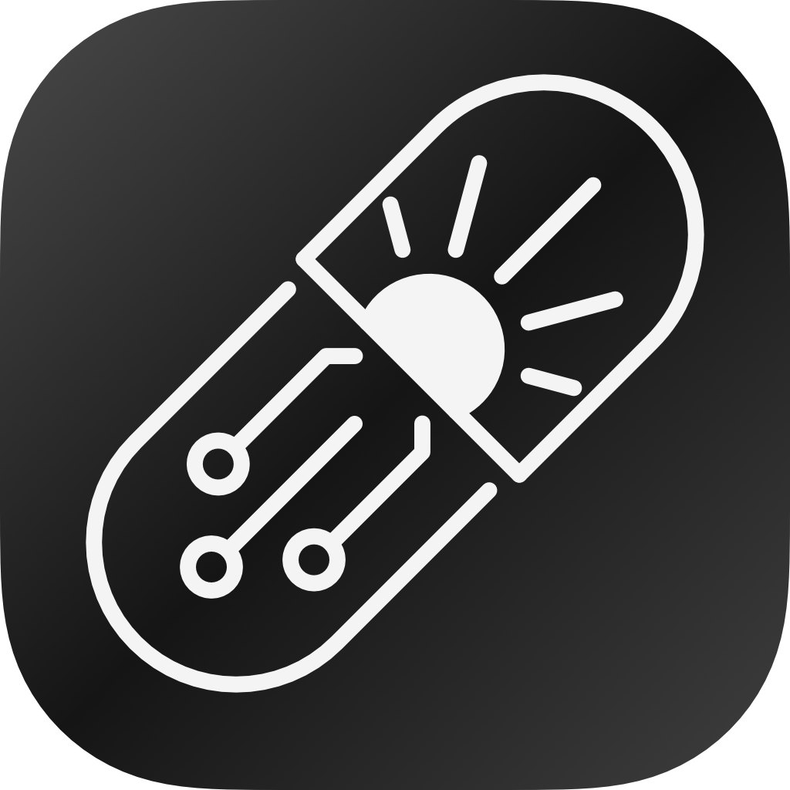
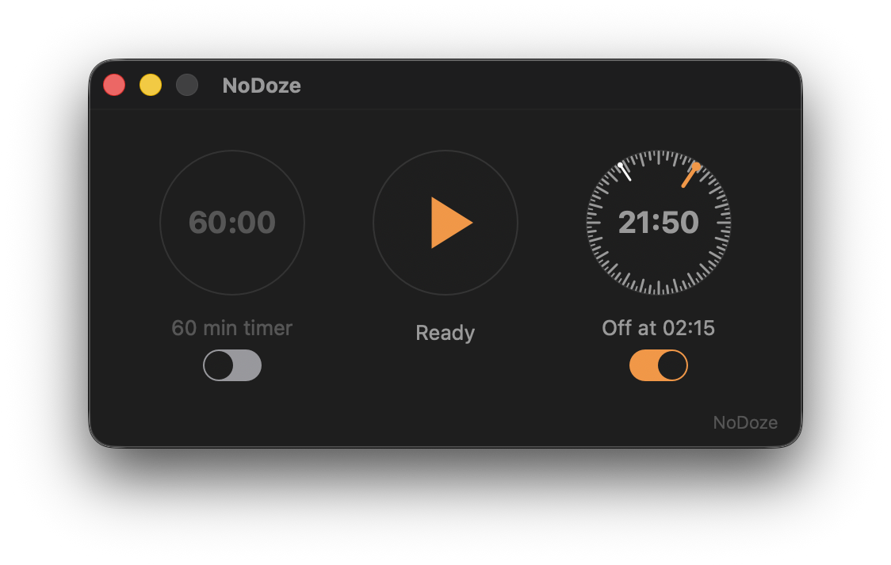

# NoDoze

<div align="center">
  

  <p><strong>A tiny macOS keep-awake app for AI agents, desktop automation, browser automation, and long-running local work.</strong></p>

  
</div>

NoDoze is a small Swift/AppKit macOS app for keeping your Mac awake while coding agents, computer-use agents, tests, builds, browsers, and other unattended workflows are running.

It is a polished GUI for `/usr/bin/caffeinate` with agent-friendly stop controls: a minute timer, a wall-clock stop dial, a menu bar status item, and screen saver handling that restores your previous setting when NoDoze stops.

## Why This Exists

AI coding agents and computer-use agents often need a Mac to stay awake while they read files, control apps, run tests, use a browser, or wait on long builds. If the display sleeps, the screen saver starts, or the session locks, desktop automation can stall.

NoDoze is built for those moments:

- keep a Mac awake for AI agent computer use
- prevent Mac sleep during Codex, local coding agents, or automation sessions
- prevent the macOS screen saver from interrupting desktop automation
- run `caffeinate` from a compact Start/Stop app instead of a Terminal window
- set an optional stop timer or wall-clock stop before starting
- keep control available from the menu bar after closing the window
- restore the previous screen saver setting on Stop or quit

## What's New In v1.1

NoDoze v1.1 is the first stable release of the new dial interface.

- Compact three-dial layout for timer, start/stop, and wall-clock stop.
- Editable timer text in the dial itself, including long durations over 60 minutes.
- Natural timer editing: click to type, type shortcuts like `1:15`, or drag vertically in 5-minute steps.
- Protected timer suffix so minute-interval timers keep the `:00` portion non-editable.
- Wall-clock dial with 1-hour and 30-minute tick marks plus 15-minute intermediate positions.
- Accurate digital wall-clock text to the minute, while the analog stop marker snaps to 15-minute intervals.
- Mutually exclusive timer and wall-clock modes: one may be armed, or both may be off.
- Timer countdown appears inside the timer dial while running.
- Improved light and dark mode colors using AppKit dynamic system colors.

## Behavior

Start:

- launches `/usr/bin/caffeinate -dimsu -w <app-pid>`
- disables the current-host screen saver idle timer
- arms the optional stop timer or wall-clock stop, if enabled

Stop, automatic stop, or quit:

- terminates `caffeinate`
- restores the previous screen saver idle timer

Interrupted previous run:

- shows a NoDoze-styled restore prompt on next launch
- displays the current screen saver idle timer beside the saved prior value
- lets you restore the saved value or keep the current setting

NoDoze uses the current user's current-host screen saver preference only. It does not install a background service.

## Build

```sh
swift build -c release
mkdir -p dist/NoDoze.app/Contents/MacOS
mkdir -p dist/NoDoze.app/Contents/Resources
cp .build/release/NoDoze dist/NoDoze.app/Contents/MacOS/NoDoze
cp Info.plist dist/NoDoze.app/Contents/Info.plist
cp Resources/NoDoze.icns dist/NoDoze.app/Contents/Resources/NoDoze.icns
chmod +x dist/NoDoze.app/Contents/MacOS/NoDoze
codesign --force --deep --sign - dist/NoDoze.app
codesign --verify --deep --strict dist/NoDoze.app
```

## Open

```sh
open dist/NoDoze.app
```

## Privacy

NoDoze has no telemetry, no analytics, no network calls, and no background service. It only starts `/usr/bin/caffeinate` and temporarily changes the current-host screen saver idle timer while running.

## License

MIT

## Search Terms

macOS keep awake app, Mac caffeinate GUI, prevent Mac sleep, disable screen saver temporarily, AI agent computer use, Codex computer use, local coding agent, desktop automation, browser automation, unattended Mac automation, Swift AppKit caffeinate app.
